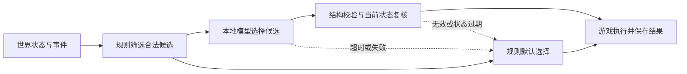

# 游戏剧情决策器的本地部署调研

核对日期：2026-09-11。目标设备为 RTX 3060 及以上、16GB 系统内存起步，并按模型与游戏同时运行设计。本文是选型与接入方案，尚未安装模型、完成 Aura 本地 provider 接入或取得目标设备实测结果。

## 建议

先用 **Qwen3.5-2B Q4_K_M** 验证剧情候选选择，用 **Qwen3.5-4B Q4_K_M** 做质量对照。研发试用使用 Ollama；随游戏部署优先评估 llama.cpp 的独立 `llama-server` 进程。中文任务的优先顺序是工程选型判断，最终由游戏自己的评测集决定，不把通用榜单当作剧情质量证明。

模型负责在合法选项中判断“现在适合发生什么”，游戏代码负责世界事实、前置条件、任务状态和执行。适用范围包括剧情节奏、任务模板选择、NPC 态度和对最近玩家行为的解释；战斗逐帧行为、寻路、奖励结算继续用确定性规则。

## 硬件与模型

“3060 以上”不能直接转换为显存下限：桌面 RTX 3060 有 8GB/12GB 配置，RTX 3060 Laptop GPU 为 6GB。应按可用显存与游戏负载分档，不能只按显卡代际或型号高低判断。[NVIDIA 桌面规格](https://www.nvidia.com/en-us/geforce/graphics-cards/30-series/rtx-3060-3060ti/)、[笔记本规格](https://www.nvidia.com/en-us/geforce/laptops/30-series/)

| 候选                | 已核对的下载体积 | 首轮用途                         |
| ------------------- | ---------------- | -------------------------------- |
| `qwen3.5:2b-q4_K_M` | 约 1.9GB         | 低配基线，选择事件/任务/NPC 态度 |
| `qwen3.5:2b-q8_0`   | 约 2.7GB         | 判断 2B 的错误是否受量化影响     |
| `qwen3.5:4b-q4_K_M` | 约 3.4GB         | 多角色关系、冲突目标的质量对照   |
| `qwen3.5:9b`        | 约 6.6GB         | 开发机质量参照，暂不作为最低配置 |

以上是 Ollama 对应模型包的大小，不是 GPU 运行占用；包内可能包含视觉组件。部署仍需计算上下文缓存、计算缓冲、推理运行时及游戏显存，纯文字场景不加载不需要的视觉组件。明确固定量化标签；`qwen3.5:2b` 当前约 2.7GB，不能把它当成 1.9GB 的 Q4 版本。[Ollama 模型标签](https://ollama.com/library/qwen3.5/tags)

建议首轮按以下方式分档，均为待实测的候选配置：

- 6GB 显存：从 2B Q4、单请求、4K 上下文开始。若游戏已占满显存，则降低模型档位、降低决策频率，或使用规则结果；不能承诺同机所有游戏都能运行。
- 8GB 显存：仍以 2B 为默认，游戏显存有余量时测试 4B。
- 12GB 及以上：可以将 4B 作为默认候选，同时保留 2B；显存更大不代表可以忽略游戏帧时间。
- 16GB 系统内存：只常驻一个模型，测系统整体提交量与换页。CPU 卸载也占系统内存，并可能争用游戏 CPU/内存带宽，不应自动视为无成本兜底。

当前开发机检测为 RTX 4080 16GB、约 64GB RAM、Ryzen 9 5900X。它适合验证功能，但无法替代 3060 + 16GB RAM 的最低配置验收。

补充对照模型可选 **Gemma 4 E2B** 和 **Ministral 3 3B Instruct**。Google 说明 E2B 的 E 指有效参数，包含 embedding 后的加载占用不能按普通 2B 估算，其 Q4_0 权重加载估计约 2.9GB，仍需额外上下文与运行时空间。Ministral 的 3B Instruct 是另一种小型指令模型，可用于检查首选模型特有的偏差；暂不为更多模型增加首轮安装成本。[Gemma 4 官方说明](https://ai.google.dev/gemma/docs/core)、[Ministral 官方模型卡](https://huggingface.co/mistralai/Ministral-3-3B-Instruct-2512)

## 运行方案

| 方案                     | 本项目中的用途                 | 需要承担的工作                                           |
| ------------------------ | ------------------------------ | -------------------------------------------------------- |
| Ollama                   | 开发期安装、切换模型与效果验证 | 外部服务生命周期、模型驻留和请求参数                     |
| llama.cpp / llama-server | 随游戏打包的本地推理进程候选   | 固定二进制与模型版本、GPU 后端、健康检查、升级与进程回收 |
| LM Studio                | 策划人员手动对照 prompt 与输出 | 桌面工具依赖；不作为当前游戏交付路径                     |

Ollama 与 llama-server 均有兼容的聊天 HTTP 接口，并支持通过 JSON Schema 约束输出。LM Studio 也提供相同方向的结构化输出能力。这里选择 Ollama 试验、llama.cpp 交付，是针对部署管理方式的建议，没有对三者作性能排名。[Ollama 结构化输出](https://docs.ollama.com/capabilities/structured-outputs)、[llama-server 文档](https://github.com/ggml-org/llama.cpp/tree/master/tools/server)、[LM Studio 文档](https://lmstudio.ai/docs/developer/openai-compat/structured-output)

在安装 Ollama 后，可逐个下载候选，避免同时加载多个模型：

```powershell
ollama pull qwen3.5:2b-q4_K_M
ollama pull qwen3.5:4b-q4_K_M
```

模型下载不等于 Aura 已接通，也不等于通过离线验收。保存模型 digest、量化类型、模板与运行时版本，断网后再次验证完整流程。随包交付时保存模型与运行时的许可证及归属信息。

llama-server 的启动示意如下，模型路径须替换为已下载、核对来源及 hash 的 GGUF 文件，二进制须使用支持该模型与下列参数的固定版本：

```powershell
& .\llama-server.exe `
  --model .\models\story-2b-q4_k_m.gguf `
  --alias aura-story-2b `
  --host 127.0.0.1 --port 11435 `
  --ctx-size 4096 --parallel 1 --n-gpu-layers 99 `
  --reasoning off
```

这是计划中的启动配置，尚未在本机运行验证。`--n-gpu-layers 99` 是尝试将可卸载层放入 GPU，不是显存硬上限；要以启动日志和运行监测确认实际放置。游戏宿主启动时预热，检查模型就绪后接受请求，退出时回收自己启动的进程。玩家路径只需呈现“本地剧情 AI”的状态与档位。

Qwen3.5-4B 官方模板默认会思考；2B 模型卡还提到思考模式可能出现循环。首轮均使用非思考模式，并实测服务端是否真正关闭，而不是仅隐藏推理文本。Ollama 原生接口使用 `think: false`；llama-server 可在启动时设置 `--reasoning off`。Qwen3.5 不正式支持 `/think` 和 `/nothink` 提示词软开关。[4B 模型卡](https://huggingface.co/Qwen/Qwen3.5-4B)、[2B 模型卡](https://huggingface.co/Qwen/Qwen3.5-2B)、[Ollama 思考参数](https://docs.ollama.com/capabilities/thinking)

## 决策协议与执行

建议的游戏运行链路：



每次只传与当前决策有关的事实：玩家近况、附近角色、相关任务、最近事件摘要，以及约 3–8 个已经合法的候选。保持权威世界状态在游戏中，不靠不断增长的聊天历史记住存档。不把全部地图、所有 NPC 或完整剧情数据库放进 prompt。

例如：玩家刚结束两场战斗、生命值偏低、村庄信任较高。游戏已排除未满足前置条件的事件，提供三个允许选项：

```json
{
  "facts": {
    "healthBand": "low",
    "recentCombatCount": 2,
    "villageTrust": "high",
    "pacingGoal": "recovery"
  },
  "candidates": [
    { "id": "inn_rest", "description": "旅店老板邀请玩家休息" },
    { "id": "village_rumor", "description": "村民提供一条可选支线线索" },
    { "id": "none", "description": "暂不触发新事件" }
  ]
}
```

模型只需返回 `{"candidateId":"inn_rest"}`。输出 Schema 为：

```json
{
  "type": "object",
  "properties": {
    "candidateId": {
      "type": "string",
      "enum": ["inn_rest", "village_rumor", "none"]
    }
  },
  "required": ["candidateId"],
  "additionalProperties": false
}
```

候选参数（目标 NPC、任务模板、奖励档位等）由游戏预先绑定到 ID。需要模型选择参数时，为每个参数提供有限合法集合，并再次校验组合条件。模型不直接写任务状态或调用任意游戏函数。

结构化解码只约束形式，不能证明“现在休息”符合剧情。业务层仍需验证选择存在、角色存活、地点可达、前置任务完成、冷却和奖励预算允许。请求携带由宿主管理的 `requestId` 与世界版本；应用结果前重查当前状态，过期结果丢弃或重评，已处理的 ID 不重复发奖。重放存档使用保存过的决策，不重新询问模型。

台词生成可以作为后续可选步骤；最小版本先用事件模板和已有台词。这样能独立回答“模型是否选对剧情”，并缩短必须等待的输出。

## 延迟与资源策略

以下是首轮实验参数，不是已经达到的指标：

| 项目           | 起点                                                    |
| -------------- | ------------------------------------------------------- |
| 上下文容量     | 4096 tokens，包含输入和输出                             |
| 实际输入       | 约 800–2000 tokens，优先减少无关设定                    |
| 输出上限       | 64–128 tokens，通常只输出候选 ID                        |
| 并发           | 1；合并被新状态替代的排队请求                           |
| 触发           | 进入区域、任务阶段变化、对话结束等事件；禁止逐帧请求    |
| 玩家等待的决策 | 以端到端 p95 ≤ 2 秒作为初始目标；3 秒截止后使用规则结果 |
| 后台剧情规划   | 可给 10 秒预算；结果过期则不执行                        |
| 采样           | 非思考模式；比较低温与模型卡推荐参数在本任务上的效果    |

截止时间包含排队、输入处理、生成和校验；由游戏保持独立的截止时钟，取消底层请求，迟到结果不能覆盖兜底结果。硬截止路径不自动重试；后台重试也必须服从同一个总预算。不要把首次加载时间混进常驻热请求，也不要忽略首次加载的玩家体验。

对输出截断、重复循环、解析失败、模型退出、显存不足、无合法候选分别定义处理方式。没有候选时直接选择 `none`；模型不可用时使用规则或预制剧情，游戏不阻塞。

内存与 GPU 计算竞争分别测量。小模型即使装得下，也可能影响渲染；优先降低触发频率、缩短输入、限制并发，并在游戏有余量的时段预生成。切到 2B 或规则模式也需要记录降级原因。

## Aura 接入现状与缺口

截至本次代码核对：

- `runtime/src/demo-model.ts` 是本地模拟模型。`api-server.ts` 的对话路由只配置演示与 Codex；演示成功不代表存在真实本地推理。
- `orchestration/src/sessions.ts` 也只在演示与 Codex 之间选择模型，不能仅下载 Ollama 模型就自动用于 Flow。
- DSH `0.1.2-rc.1` 的 `dsh-llm-pi-ai` 支持自定义 `api`、`baseURL`、`models`、兼容参数和凭据引用，可作为本地兼容端点的接入基础。
- 当前 DSH `GenerateOptions` 与该 provider 配置没有直接的 `response_format` / JSON Schema 输出选项。现有 Flow 的 Zod 出参校验发生在执行结果上，不能视为服务端的约束解码。

建议继续遵守既有 DSH 边界：

```text
游戏 → Aura Hono API → 常驻 DSH 模型服务 → 本地推理进程
```

最小接入先验证 DSH 自定义 provider + 短文本候选 ID + 严格结果校验和规则兜底。任务决策可通过长驻 DSH 的公开 LLM service seam 做单次调用，避免每次启动完整对话进程和不必要的多轮工具循环；耗时和日志成本也要纳入验收。

需要强制 JSON Schema 解码时，先核对是否有兼容的 DSH 发布版本已提供该能力；若没有，通过 Aura 自有 DSH provider 插件的公开 service seam 接入本地服务，或者向上游补充能力。不要修改 `node_modules`，不要由前端、Flow 或新增独立客户端绕开 DSH，也不要把“请只输出 JSON”的 prompt 描述成格式保证。

拟接入配置可参考下列片段，**它仅说明 provider 声明，不是当前 Aura 已支持的开关**：

```yaml
- id: llm-pi-ai
  config:
    providers:
      aura-local:
        displayName: 本地剧情模型
        api: openai-completions
        baseURL: http://127.0.0.1:11435/v1
        apiKeyEnv: AURA_LOCAL_MODEL_KEY
        timeoutMs: 3000
        retryPolicy:
          mode: normal
          maxRetries: 0
        compat:
          supportsStore: false
          supportsDeveloperRole: false
          supportsReasoningEffort: false
          maxTokensField: max_tokens
        models:
          - id: aura-story-2b
            contextWindow: 4096
            maxTokens: 128
            input: [text]
```

上述配置以启动时已关闭思考的 llama-server 为前提。DSH 说明兼容客户端对无鉴权服务也可能要求占位凭据；`AURA_LOCAL_MODEL_KEY` 是凭据引用名，占位值通过后端 DSH 凭据服务配置。真实部署凭据仍只保存在忽略的 `.aura/` 存储，不能回传前端。Ollama 改用其地址与实际模型 ID，并单独验证关闭思考的参数映射，不能照搬 llama-server 的启动配置。

实现时，进程管理、配置和健康检查留在 backend/runtime 的独立 TypeScript 模块；可复用的确定性决策类型与校验放 shared；DSH provider 插件属于 backend。游戏交付优先使用无界面的 server 宿主，减少常驻桌面 UI 开销。需要改包位置或依赖时仍按架构规则验证。

## 第一轮验收

先准备约 100 个代表性状态，每个至少重复 3 次，比较纯规则、2B Q4 与 4B Q4。每个状态由策划定义允许的优选集合与不可接受结果，允许多个合理选择。样例覆盖节奏变化、低血量、关系冲突、已完成任务、死亡角色、重复事件、无候选和请求期间世界变化。

| 维度     | 必须记录的结果                                                     |
| -------- | ------------------------------------------------------------------ |
| 选择质量 | 相对纯规则的盲评偏好、符合优选集合的比例、重复与单调程度           |
| 有效性   | 首次解析成功率、候选合法率、兜底率，不能用兜底掩盖模型错误         |
| 世界约束 | 死亡角色、奖励、前置条件等检查的拒绝记录；执行器测试不允许非法提交 |
| 时延     | 冷启动、热请求端到端 p50/p95/p99、超时比例及排队时间               |
| 资源     | 峰值显存、系统内存提交量、换页、GPU 利用率                         |
| 游戏体验 | 同一场景 AI 开/关的帧时间分布、1% low、剧情等待时间                |
| 故障恢复 | 断网、进程退出、取消、重复提交、存档重放及过期回复                 |

2B 选择质量不足时，先检查候选是否含糊、事实是否缺失，再比较 4B；若 4B 明显改善但不满足资源目标，再考虑用经过筛选的高质量决策数据微调 2B，并保留独立验证集。微调不是第一轮部署的前置条件。

首轮通过的含义是：真实游戏状态下，模型相对规则有可观察的体验收益，失败会正确兜底，并在最低配置游戏同时运行时满足约定预算。有限样本不能证明永不出错，确定性执行校验需要一直存在。
